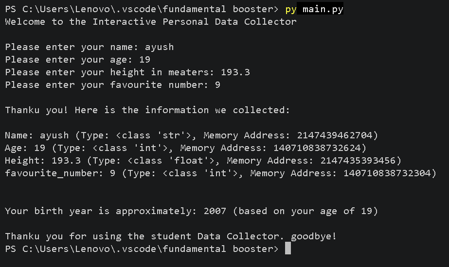

# Interactive Personal Data Collector

## 1\. Project

- **Project Name:** Interactive Personal Data Collector
- **Programming Language:** Python
- **Project Type:** Beginner Python Project

## 2\. Project Description

The **Interactive Personal Data Collector** is a beginner-friendly Python project designed to collect personal information from users and display it in an organized format.

The program asks the user to enter their name, age, height in meters, and favourite number. It displays the collected information along with the data type and memory address of each variable using Python's built-in `type()` and `id()` functions.

The program also calculates the user's approximate birth year by subtracting their age from the current year (2026).

This project helps beginners understand fundamental Python concepts such as variables, user input, data types, type conversion, memory addresses, formatted output, and basic arithmetic operations.

## 3\. Features

| No. | Feature | Description |
| --- | --- | --- |
| 1 | Personal Data Collection | Collects the user's name, age, height, and favourite number. |
| 2 | Data Types | Uses `str`, `int`, and `float` data types. |
| 3 | Type Identification | Displays variable data types using Python's `type()` function. |
| 4 | Memory Address | Displays variable memory addresses using Python's `id()` function. |
| 5 | Birth Year Calculation | Calculates the approximate birth year based on the user's age. |
| 6 | Formatted Output | Uses f-strings to display information clearly. |
| 7 | Interactive Interface | Interacts with the user through the terminal. |
| 8 | Basic Calculations | Demonstrates arithmetic operations using Python. |

## 4\. Technologies Used

| No. | Technology | Purpose |
| --- | --- | --- |
| 1 | Python | Used to develop the program and implement its functionality. |
| 2 | Visual Studio Code (VS Code) | Used to write, edit, and run the Python code. |
| 3 | Git | Used for version control and tracking code changes. |
| 4 | GitHub | Used to host the project repository and share the source code. |

## 5\. How to Run | Installation

Follow these steps to install and run the project on your computer.

### Prerequisites

Make sure you have installed the following:

- Python 3
- Visual Studio Code
- Git (optional, for cloning the repository)

### Step 1: Clone the Repository

Open your terminal and run:

bash

```
git clone <your-github-repository-url>
```

Replace `<your-github-repository-url>` with your actual GitHub repository URL.

### Step 2: Navigate to the Project Folder

bash

```
cd interactive-personal-data-collector
```

Make sure the folder name matches your actual project directory.

### Step 3: Run the Python Program

If your Python file is named `main.py`, run:

bash

```
python main.py
```

On some systems, use:

bash

```
python3 main.py
```

### Step 4: Enter Your Information

Enter the requested information when prompted:

- Name
- Age
- Height in meters
- Favourite number

The program will display your information, data types, memory addresses, and approximate birth year.

## 6\. Project Structure

The project can be organized using the following folder structure:

text

```
├── main.py
├── README.md
├── output.png
```

### File Description

| File/Folder | Description |
| --- | --- |
| `main.py` | Contains the Python source code for collecting and displaying personal information. |
| `README.md` | Provides the project description, features, technologies, and instructions. |
| `.gitignore` | Specifies files and folders that Git should ignore. |
| `screenshots/` | Stores screenshots of the source code and program output. |


## 7\. Output | Screenshots
### Screenshots


## 8. Author

- **Author:**Ayush Chand

---
